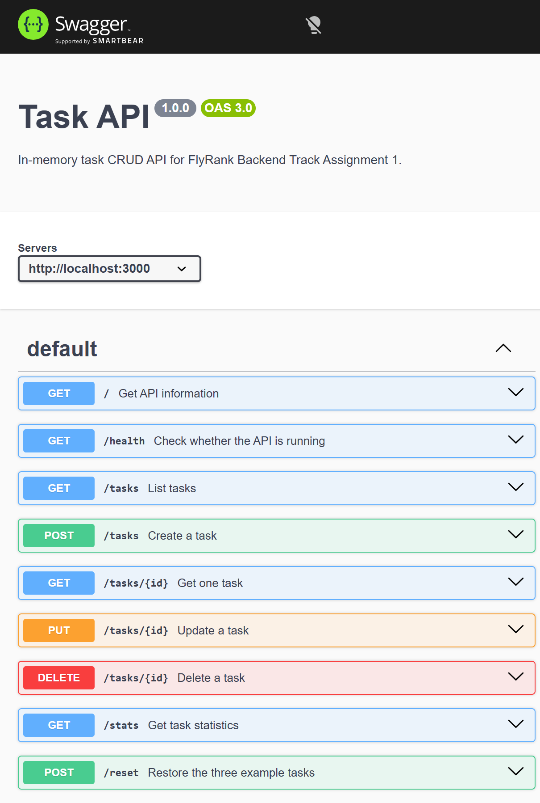

# Assignment 01: Build your first CRUD API

An Express API for managing an in-memory to-do list, built for the FlyRank
Internship Backend Track, Week 2, Assignment 1. It demonstrates HTTP,
CRUD, status codes, Swagger UI, and GitHub-ready project organization.
Task data is intentionally lost when the server restarts; there is no database.

## Requirements

- Node.js and npm

## Install and run

From this folder:

```powershell
npm install
npm start
```

The server listens at `http://localhost:3000`. Interactive Swagger UI is
available at [http://localhost:3000/docs](http://localhost:3000/docs).
Swagger UI uses the OpenAPI description in `openapi.json`.

## Endpoints

| Method | Path | Purpose |
| --- | --- | --- |
| GET | `/` | API name, version, and endpoints |
| GET | `/health` | Health check |
| GET | `/tasks` | List all tasks |
| GET | `/tasks?done=true` | Filter by completion status |
| GET | `/tasks?search=milk` | Search titles, case-insensitively |
| GET | `/tasks/{id}` | Get one task |
| POST | `/tasks` | Create a task (201) |
| PUT | `/tasks/{id}` | Update title and/or completion (200) |
| DELETE | `/tasks/{id}` | Delete a task (204, empty response) |
| GET | `/stats` | Count total, done, and open tasks |
| POST | `/reset` | Restore the example tasks |

Task objects have an `id`, `title`, and `done` field. Invalid request bodies
return status 400 with a JSON `error`. Unknown task IDs return status 404 with
a JSON `error`.

## Test with curl

Create a task:

```powershell
curl.exe -i -X POST http://localhost:3000/tasks -H "Content-Type: application/json" -d '{ "title": "Buy milk" }'
```

Example response:

```text
HTTP/1.1 201 Created
Content-Type: application/json; charset=utf-8

{"id":4,"title":"Buy milk","done":false}
```

You can also open `/docs` and use **Try it out** for the full CRUD cycle.

Run the automated endpoint checks with:

```powershell
npm test
```

## In-memory behavior

The three example tasks are created when the server starts. Create a task and
restart the server: the new task disappears because it was held only in the
process's in-memory list. Assignment 2 adds persistent SQLite storage.

## Swagger UI screenshot


