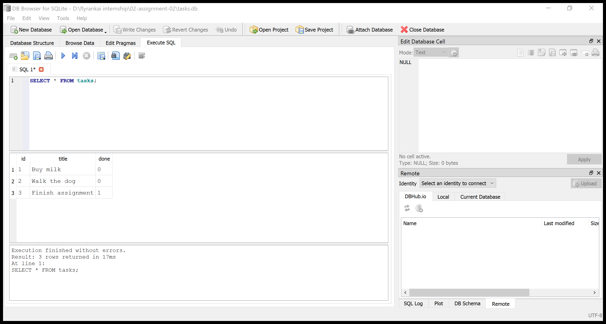

# Assignment 02: Connect the CRUD API to SQLite

This is Assignment 01's JavaScript/Express task API with its storage moved from
an in-memory list to SQLite. It uses `better-sqlite3`, the synchronous SQLite
library selected for the JavaScript track. The client-facing endpoints and
task response shape (`id`, `title`, `done`) stay the same.

## Install and run

Requirements: Node.js and npm.

From this folder:

```powershell
npm install
npm start
```

On first start, the server creates `tasks.db`, creates the `tasks` table, and
inserts the three example tasks if and only if the table is empty. The database
file is in this folder and is ignored by Git, so a fresh clone creates its own
database automatically. The API listens at `http://localhost:3000`; Swagger UI
is at [http://localhost:3000/docs](http://localhost:3000/docs).

## Endpoints

| Method | Path | Purpose |
| --- | --- | --- |
| GET | `/` | API name, version, and endpoints |
| GET | `/health` | Health check |
| GET | `/tasks` | List all tasks |
| GET | `/tasks?done=true` | Filter by completion status |
| GET | `/tasks?search=milk` | Search titles with SQL `LIKE` |
| GET | `/tasks/{id}` | Get one task |
| POST | `/tasks` | Create a task (201) |
| PUT | `/tasks/{id}` | Update title and/or completion |
| DELETE | `/tasks/{id}` | Delete a task (204, empty response) |
| GET | `/stats` | Count total, done, and open tasks |
| POST | `/reset` | Restore the three example tasks |

Invalid task input returns 400 with a JSON `error`. Unknown task IDs return 404
with a JSON `error`. The list, create, update, and delete routes use prepared
SQL statements with `?` parameters.

## Checkpoints

The automated test suite checks that the database and table are created, the
seed runs once, the API responses and status codes match Assignment 01, writes
survive restarting the app, and a direct database update appears immediately
through the API.

Run the tests:

```powershell
npm test
```

Manual CRUD example:

```powershell
curl.exe -i -X POST http://localhost:3000/tasks -H "Content-Type: application/json" -d '{ "title": "Buy milk" }'
```

The successful response is 201 Created and includes the ID assigned by
SQLite. Stop and restart the server, then use `GET /tasks` to confirm the new
task is still present.

## SQLite and Stage 4

SQLite is one database file, requires no database server, and keeps the task
data across application restarts. The database is created at `tasks.db` in
this folder.

Open `tasks.db` in DB Browser for SQLite and use the Execute SQL tab:

```sql
SELECT * FROM tasks;
SELECT * FROM tasks WHERE done = 1;
SELECT COUNT(*) FROM tasks;
UPDATE tasks SET done = 1;
DELETE FROM tasks WHERE done = 1;
```

`SELECT * FROM tasks WHERE done = 1;` returns the completed example task,
`Finish assignment`, in a fresh database. The same database file is used by
the API, so a committed DB Browser update is visible to the next `GET /tasks`
request without restarting the server.

For this checkpoint, `SELECT * FROM tasks;` returned the three seed rows.
Running `UPDATE tasks SET done = 1;` and writing the change in DB Browser made
all three API results show `done: true`. Running
`DELETE FROM tasks WHERE done = 1;` then made `GET /tasks` return an empty list;
`POST /reset` restored the examples.

### DB Browser screenshot



## Why the API is unchanged

The Assignment 01 request/response and status-code checks are repeated by the
Assignment 02 tests. The same checks pass while data is read from and written
to SQLite; only the storage implementation changed.
