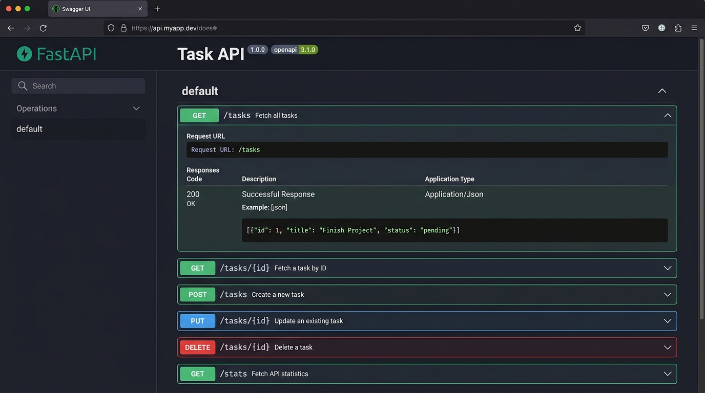

# Task API

A simple CRUD API for managing a to-do list, built with FastAPI during the FlyRank Internship Backend Track.

## Quick Start

### Prerequisites
- Python 3.10+
- pip

### Installation & Running

```bash
pip install fastapi uvicorn --break-system-packages
uvicorn main:app --reload --port 8000
```

Then open http://localhost:8000/docs to see Swagger UI.

## Endpoints

| Method | Path | Purpose |
|--------|------|---------|
| GET | `/` | API information |
| GET | `/health` | Health check |
| GET | `/tasks` | List all tasks |
| GET | `/tasks/{id}` | Get one task |
| POST | `/tasks` | Create a task |
| PUT | `/tasks/{id}` | Update a task |
| DELETE | `/tasks/{id}` | Delete a task |
| GET | `/tasks/filter/done` | Filter tasks by done status |
| GET | `/tasks/search/{query}` | Search tasks by title |
| GET | `/stats` | Task statistics |
| POST | `/reset` | Reset tasks to initial state |

## Example Usage

### Create a task
```bash
curl -i -X POST http://localhost:8000/tasks \
  -H "Content-Type: application/json" \
  -d '{"title":"Buy milk"}'
```

**Response:**

```http
HTTP/1.1 201 Created

{"id":4,"title":"Buy milk","done":false}
```

### Get all tasks
```bash
curl -i http://localhost:8000/tasks
```

### Update a task
```bash
curl -i -X PUT http://localhost:8000/tasks/4 \
  -H "Content-Type: application/json" \
  -d '{"title":"Buy organic milk","done":true}'
```

### Delete a task
```bash
curl -i -X DELETE http://localhost:8000/tasks/4
```

**Response:**

```http
HTTP/1.1 204 No Content
```

## Swagger UI

Interactive API documentation is available at `/docs` when the server is running.



## Notes

- Tasks are stored **in memory only** — data is lost when the server restarts
- Input validation: title cannot be empty
- Proper HTTP status codes: 200 (OK), 201 (Created), 204 (No Content), 400 (Bad Request), 404 (Not Found)

### Mortality Experiment

Created a task while the server was running. Stopped the server, restarted it, and checked `GET /tasks`.

**Result:** The newly created task disappeared. Only the hardcoded initial 3 tasks remained.

**Why:** All data is stored in Python variables in memory. When the process stops, RAM is cleared. The code is re-executed from scratch, reloading only the hardcoded tasks. This is why databases exist — they persist data to disk.
